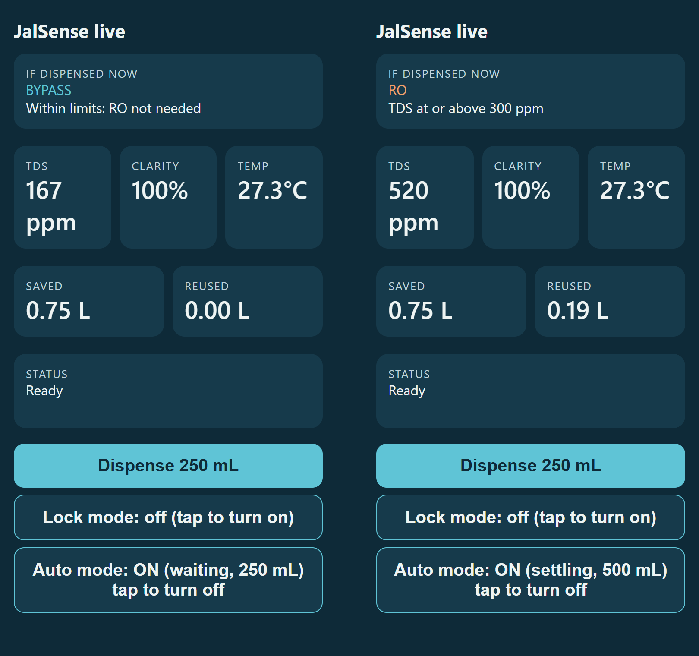

<div align="center">

# JalSense

**A smart retrofit for home RO water purifiers: purify only what needs purifying.**

[](LICENSE)
[](firmware/)
[](firmware/)
[](#the-problem)
[](wokwi/README.md)

[Quick start](#quick-start) · [How it decides](#how-jalsense-decides) · [Live dashboard](#live-dashboard) · [Hardware](#hardware-and-build-sheets) · [Documentation](#documentation)

<br>


</div>

JalSense reads the incoming water and runs the purifier's reverse-osmosis (RO) membrane **only when the water actually needs it**. When it does, the salty reject water goes to a reuse tank instead of the drain. It fits the purifier a family already owns.

This repository holds the ESP32 firmware, the hardware design (schematic, breadboard layout and exploded views), the documentation, and a browser simulation. JalSense supports UN Sustainable Development Goal 6, Clean Water and Sanitation, and was selected for the prototype round of an SDG hackathon (October 2026, about 150 teams).

## Contents

- [The problem](#the-problem)
- [How JalSense decides](#how-jalsense-decides)
- [Quick start](#quick-start)
- [The prototype](#the-prototype)
- [Firmware](#firmware)
- [Live dashboard](#live-dashboard)
- [Hardware and build sheets](#hardware-and-build-sheets)
- [Try it in the browser](#try-it-in-the-browser)
- [Documentation](#documentation)
- [Repository layout](#repository-layout)
- [Project status](#project-status)
- [Real and simulated in the demo rig](#real-and-simulated-in-the-demo-rig)
- [Limits](#limits)
- [Team](#team) · [Sources](#sources) · [License](#license)

## The problem

- RO filtration sends **50–80% of its feed water** down the drain as reject. For every litre drunk, one to four litres are thrown away. [1]
- An expert committee told India's National Green Tribunal that **below 500 mg/L TDS, RO is not useful**: it strips important minerals and wastes water. [2] The NGT's order to restrict RO was later stayed by the Supreme Court [3], so homes still have no practical fix.
- Bengaluru needed about **2,600 million litres a day** in the 2024 crisis and was about **500 million litres short**; around 60% of residents relied on tanker water. [4]

Households can't tell when their water actually needs RO, so they run it on every litre.

## How JalSense decides

> If the incoming water is under 300 ppm TDS and clear, skip the RO membrane. Otherwise run RO and send the reject to a reuse tank. Any sensor fault, or lock mode, forces RO.

| If the sensors read… | JalSense does this |
|---|---|
| Clarity at least 85% of clear water and TDS below 300 ppm | **Bypass**: UF + UV only, RO skipped |
| Cloudy water, or TDS at or above 300 ppm | **RO**, reject to the reuse tank |
| TDS signal under 150 mV (dry probe, or too low to trust), or turbidity signal under 0.3 V | **RO** (fail-safe) |
| Lock mode on, for arsenic or fluoride areas | **RO**, always |

UV/UF disinfection stays on in both paths; only the RO membrane is skipped. The fault checks run before the water-quality checks, so a broken sensor can never cause a bypass. Clarity is checked before TDS because dissolved salts and suspended particles are independent: low-TDS water can still be cloudy.

<div align="center">

</div>

## Quick start

You need an ESP32 DevKit and the parts in [`hardware/bom.csv`](hardware/bom.csv), wired as in the [schematic](hardware/jalsense-circuit-schematic-v2.png) or the [breadboard layout](hardware/jalsense-breadboard-build-v2.png).

1. **Install the tools.** Arduino IDE 2, then *esp32 by Espressif Systems* in Boards Manager, and the libraries *OneWire*, *DallasTemperature*, *Adafruit SSD1306* (with Adafruit GFX and BusIO).
2. **Upload the firmware.** Open [`firmware/JalSense_auto/JalSense_auto.ino`](firmware/JalSense_auto/JalSense_auto.ino), choose the board *ESP32 Dev Module*, set *Upload Speed* to 115200, and upload. If it stalls at "Connecting…", hold the BOOT button.
3. **Calibrate** from the Serial Monitor (115200 baud, Newline): `p<ppm>` for TDS against a pen meter, `c` for clear water, and `a` / `b` for the pump rates. Step by step: [`docs/calibration.md`](docs/calibration.md).
4. **Open the dashboard.** Join Wi-Fi `JalSense-Demo` (password `jalsense123`), turn mobile data off, and browse to `http://192.168.4.1`.
5. **Run the demo.** The one-page [build and demo guide](docs/build-and-demo-guide.pdf) and the [demo script](docs/demo-script.md) walk through it.

## The prototype

A bench rig built on a breadboard from off-the-shelf modules:

| Block | Parts |
|---|---|
| Controller | ESP32-WROOM-32 DevKit (38-pin) |
| Sensing | Analog TDS meter V1.0, turbidity sensor module, DS18B20 waterproof temperature probe, YF-S201 flow sensor on the bypass line |
| Switching | 5 V dual relay module with optocouplers, driving two 3–6 V submersible pumps (pump A = bypass path, pump B = RO path) |
| Interface | 0.96" OLED (SSD1306 or SH1106 chip), the ESP32's BOOT button as Dispense, a GPIO23 jumper or the phone as lock mode, and a phone dashboard over the ESP32's own Wi-Fi |
| Power | One 5 V 2 A adapter for the pumps and relay; the ESP32 on USB, with the grounds joined |

In a home, mains or tank pressure feeds the purifier and two solenoid valves choose the path. On the bench there's no pressure, so two small pumps play the part of those valves; the sensing, decision logic and relay control are the same.

<div align="center">

</div>

## Firmware

| Sketch | Use it for |
|---|---|
| [`firmware/JalSense_auto/`](firmware/JalSense_auto/JalSense_auto.ino) | **The latest build.** Everything below, plus Auto mode, SH1106 OLED support and a faster Wi-Fi hotspot |
| [`firmware/JalSense/`](firmware/JalSense/JalSense.ino) | The original sketch. It also builds the Wokwi simulation (`#define JALSENSE_SIM 1`) |
| [`firmware/tools/`](firmware/tools/) | `OLED_test` and `OLED_test2`: display and I2C checks |

What the firmware does:

- Reads TDS (temperature-compensated), clarity and temperature every second, using the ESP32's calibrated millivolt readings and a 21-sample median filter
- Fail-safe decision logic: lock mode and sensor faults are checked first
- Relays are active-LOW and set OFF before anything else at start-up
- Dispenses 250 mL: measured by the flow sensor on the bypass path and by calibrated pump run time on the RO path; the bypass pump stops after 3 s of no flow; 20 s cap on every run
- **Auto mode** (`JalSense_auto`): the pumps start by themselves from the TDS and clarity readings. The decision must hold for 3 s, it pauses on a sensor fault, and it switches itself off after 1 L or on a "No flow" or "Timeout" error
- Litres saved (bypass) and reused (RO reject) counted per session
- OLED readout and a phone dashboard from the ESP32's own Wi-Fi hotspot, with Dispense, Lock and Auto buttons
- Calibration over the serial monitor, stored in flash

Compiles on ESP32 Arduino core 3.3.12. The original sketch builds without warnings, both as the hardware build and the Wokwi build. `JalSense_auto` reports a high TDS before cloudiness when both apply; the decision (RO) is the same. What changed while building the rig, and why: [`docs/prototype-build-notes.md`](docs/prototype-build-notes.md).

<details>
<summary><b>Serial commands</b> (115200 baud, Newline)</summary>

| Command | Does |
|---|---|
| `s` | print current readings and the decision |
| `p180` | calibrate TDS against a TDS pen reading of 180 ppm |
| `c` | clear-water calibration for the turbidity sensor |
| `a` / `b`, then `ma210` / `mb190` | run pump A / B for 10 s into a jug, then save the volume |
| `r`, then `l960` | flow calibration: reset pulses, dispense into a jug, enter mL collected |
| `o` | turn auto mode on or off (`JalSense_auto`) |
| `x` | reset calibration to defaults |

</details>

## Live dashboard

The ESP32 serves a small website over its own Wi-Fi hotspot, so you can watch the device from a phone with no internet:

1. Join Wi-Fi `JalSense-Demo` (password `jalsense123`), turn off mobile data.
2. Open `http://192.168.4.1`.
3. See the decision (BYPASS or RO) and its reason, TDS, clarity, temperature, litres saved and reused, and the pump status, updated about twice a second. Buttons: **Dispense 250 mL**, **Lock mode**, **Auto mode**.

<div align="center">

<br>
<sub>The dashboard on a phone: BYPASS for clean water (left) and RO for high TDS (right). Rendered from the firmware's own page with sample readings.</sub>
</div>

The same numbers are available as JSON at `http://192.168.4.1/data`. This is a local page served by the board, not an online website. Details, the JSON fields and ideas for remote monitoring: [`docs/phone-dashboard.md`](docs/phone-dashboard.md).

## Hardware and build sheets

Full parts list, wiring table and pre-power checklist: [`hardware/`](hardware/README.md).

<div align="center">

<br>
<sub>Circuit schematic of the prototype as built (<a href="hardware/jalsense-circuit-schematic-v2.svg">SVG</a>)</sub>
</div>

| Sheet | What it shows |
|---|---|
| [Schematic, as built](hardware/jalsense-circuit-schematic-v2.png) | the working prototype: 5.5 kΩ resistors, relay VCC on 5 V, analog TDS meter on GPIO34 |
| [Breadboard layout](hardware/jalsense-breadboard-build-v2.png) | every wire, hole by hole, with a wiring table |
| [Prototype exploded view](hardware/jalsense-prototype-exploded-view.png) | the bench rig, pulled apart ([4K](hardware/jalsense-prototype-exploded-view-4k.png)) |
| [Retrofit exploded view](hardware/jalsense-retrofit-exploded-view.png) | the retrofit unit that would go inside a purifier |
| [Original wiring drawing](hardware/jalsense-wiring.png) | the first design drawing, kept for reference |

Product photos on the build sheets belong to their owners, as named in each sheet's footer; the drawings themselves are original.

## Try it in the browser

The [`wokwi/`](wokwi/README.md) folder runs the same firmware on a simulated ESP32 in [Wokwi](https://wokwi.com), with knobs standing in for the TDS and turbidity sensors and LEDs for the pumps.

## Documentation

| Page | What is in it |
|---|---|
| [`docs/calibration.md`](docs/calibration.md) | calibration steps, TDS sensor output table, firmware settings |
| [`docs/phone-dashboard.md`](docs/phone-dashboard.md) | the live dashboard: how to open it, what it shows, the JSON |
| [`docs/prototype-build-notes.md`](docs/prototype-build-notes.md) | what changed while building the rig, and the wiring lessons |
| [`docs/build-and-demo-guide.pdf`](docs/build-and-demo-guide.pdf) | one-page build and demo guide ([HTML](docs/build-and-demo-guide.html)) |
| [`docs/demo-script.md`](docs/demo-script.md) | the live demo, act by act |
| [`docs/troubleshooting.md`](docs/troubleshooting.md) | symptoms, causes and fixes |
| [`docs/design-notes.md`](docs/design-notes.md) | why each part of the circuit is there |
| [`docs/faq.md`](docs/faq.md) | questions about safety and feasibility |

## Repository layout

```
jalsense/
├── firmware/
│   ├── JalSense_auto/        latest firmware: auto mode, SH1106 OLED support, faster hotspot
│   ├── JalSense/             original firmware (also builds the Wokwi simulation)
│   └── tools/                OLED_test, OLED_test2
├── wokwi/                    browser simulation (diagram.json, sketch.ino)
├── hardware/                 parts list, wiring table, schematic, breadboard and exploded views
└── docs/                     calibration, dashboard, build notes, guide, demo script, FAQ
```

## Project status

- [x] Concept, research and pitch (round one)
- [x] Wiring design and parts list
- [x] Firmware written and compiling for ESP32, with a Wokwi simulation project
- [x] Bench prototype built and running on real hardware (sensors, relays, pumps, OLED and phone dashboard)
- [ ] Longer reliability testing, measured results and photos

The firmware runs on the real hardware. This section will be updated with photos and measured results.

## Real and simulated in the demo rig

The sensing, decision, pump switching, flow metering, fail-safes and dashboards are real. The RO membrane and the UF/UV stages are represented by labelled jars, two pumps stand in for the two valves a real retrofit would use, and the reject volume on the RO path is calculated at 75% of that path's volume, inside the 50–80% range RO units waste.

## Limits

- TDS does not detect microbes, so UV/UF disinfection always stays on.
- TDS does not detect arsenic, fluoride or nitrate; homes in affected areas use lock mode, set from a lab test or the district groundwater report.
- The ESP32's ADC is accurate only above about 150 mV, so water under about 60 ppm reads as "unknown" and runs RO. A product version would add a 16-bit ADC.
- The hobby-grade turbidity sensor detects visibly cloudy water but cannot resolve 1 NTU; a product version would use a nephelometric sensor.
- The analog TDS meter reads 0 to 1000 ppm; water far above that saturates it and can read wrongly low. Use a wider-range conductivity sensor for high-TDS sources.
- Household savings figures are estimates (10 L/day purified at a 75% reject rate) until a pilot measures them.
- This is a prototype. It has not been tested for drinking-water safety.

## Team

Built by Team JalSense for an SDG hackathon. Maintained by [Miheer Nikam](https://github.com/nmiheer715-hue), Electrical and Electronics Engineering, BMS College of Engineering, Bengaluru.

## Sources

1. [Deccan Herald: RO filters waste 50–80% of feed water](https://www.deccanherald.com/opinion/regulatory-vacuum-unregulated-splurge-2144644)
2. [The Tribune: NGT order on RO below 500 mg/L TDS](https://www.tribuneindia.com/news/archive/nation/ngt-ban-ros-where-dissolved-solids-in-water-below-500-mg-l-779571)
3. [Verdictum: Supreme Court stays the NGT order](https://www.verdictum.in/top-stories/sc-stays-order-of-ngt-directing-cpcb-to-ban-water-purifiers-with-tds-below-500-mgl-1357253)
4. [Business Today: Bengaluru water shortfall, March 2024](https://www.businesstoday.in/india/story/bengaluru-facing-shortage-of-500-million-litres-water-shortage-per-day-says-karnataka-cm-421978-2024-03-19)
5. [DFRobot SEN0244 analog TDS sensor](https://wiki.dfrobot.com/sen0244/)
6. [Espressif ESP-IDF: ESP32 ADC](https://docs.espressif.com/projects/esp-idf/en/v4.4.8/esp32/api-reference/peripherals/adc.html)
7. [Wokwi relay module reference](https://docs.wokwi.com/parts/wokwi-relay-module)
8. Bureau of Indian Standards, IS 10500:2012 Drinking Water Specification

## License

Released under the [MIT License](LICENSE).
