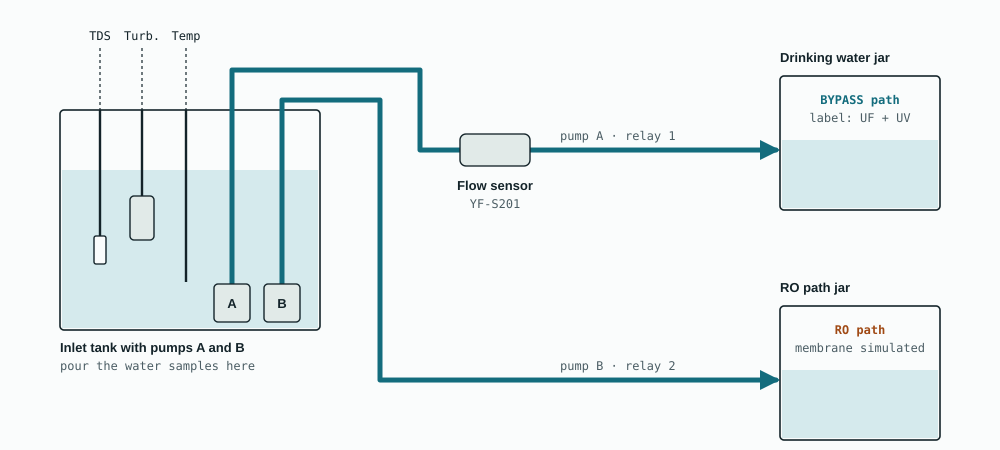
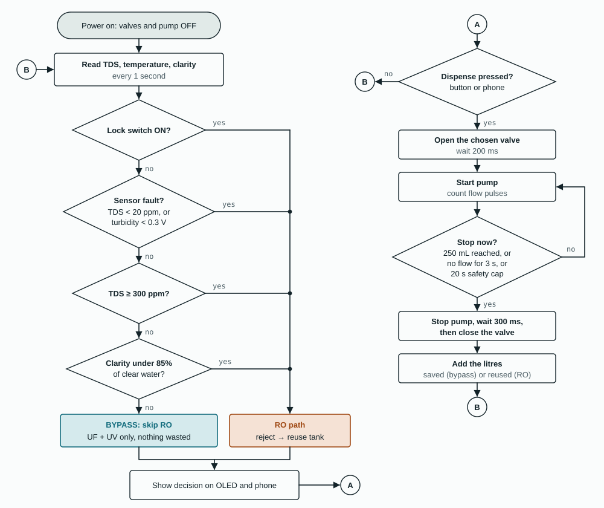
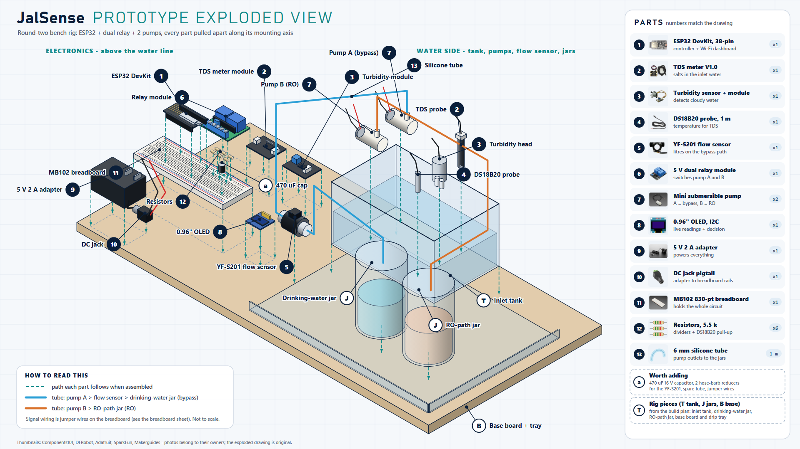

# JalSense

**A smart retrofit for home RO water purifiers: purify only what needs purifying.**

JalSense reads the incoming water and runs the purifier's reverse-osmosis (RO) membrane only when the water actually needs it. When it does, the salty reject water goes to a reuse tank instead of the drain. It fits the purifier a family already owns.

UN Sustainable Development Goal 6, Clean Water and Sanitation. Selected for the prototype round of an SDG hackathon (October 2026, about 150 teams).



## The problem

- RO filtration sends **50–80% of its feed water** down the drain as reject. For every litre drunk, one to four litres are thrown away. [1]
- An expert committee told India's National Green Tribunal that **below 500 mg/L TDS, RO is not useful**: it strips important minerals and wastes water. [2] The NGT's order to restrict RO was later stayed by the Supreme Court [3], so homes still have no practical fix.
- Bengaluru needed about **2,600 million litres a day** in the 2024 crisis and was about **500 million litres short**; around 60% of residents relied on tanker water. [4]

Households can't tell when their water actually needs RO, so they run it on every litre.

## How JalSense decides

> If the incoming water is under 300 ppm TDS and clear, skip the RO membrane. Otherwise run RO and send the reject to a reuse tank. Any sensor fault, or lock mode, forces RO.

| If the sensors read… | JalSense does this |
|---|---|
| Clarity at least 85% of clear water and TDS below 300 ppm | **Bypass**: UF + UV only, RO skipped |
| Cloudy water, or TDS at or above 300 ppm | **RO**, reject to the reuse tank |
| TDS signal under 150 mV (dry probe, or too low to trust), or turbidity signal under 0.3 V | **RO** (fail-safe) |
| Lock mode on, for arsenic or fluoride areas | **RO**, always |

UV/UF disinfection stays on in both paths; only the RO membrane is skipped. The fault checks run before the water-quality checks, so a broken sensor can never cause a bypass. Clarity is checked before TDS because dissolved salts and suspended particles are independent: low-TDS water can still be cloudy.



## The prototype

A bench rig built on a breadboard from off-the-shelf modules:

| Block | Parts |
|---|---|
| Controller | ESP32-WROOM-32 DevKit (38-pin) |
| Sensing | Analog TDS meter V1.0, turbidity sensor module, DS18B20 waterproof temperature probe, YF-S201 flow sensor on the bypass line |
| Switching | 5 V dual relay module with optocouplers, driving two 3–6 V submersible pumps (pump A = bypass path, pump B = RO path) |
| Interface | 0.96" OLED (SSD1306 or SH1106 chip), the ESP32's BOOT button as Dispense, a GPIO23 jumper or the phone as lock mode, and a phone dashboard over the ESP32's own Wi-Fi |
| Power | One 5 V 2 A adapter for the pumps and relay; the ESP32 on USB, with the grounds joined |

In a home, mains or tank pressure feeds the purifier and two solenoid valves choose the path. On the bench there's no pressure, so two small pumps play the part of those valves; the sensing, decision logic and relay control are the same.


Full parts list, wiring table and pre-power checklist: [`hardware/`](hardware/README.md). A high-resolution PNG of the wiring diagram is in [`hardware/jalsense-wiring.png`](hardware/jalsense-wiring.png). The schematic of the **prototype as built** (5.5 kΩ resistors, relay VCC on 5 V) is [`hardware/jalsense-circuit-schematic-v2.png`](hardware/jalsense-circuit-schematic-v2.png).



Breadboard layout, hole by hole: [`hardware/jalsense-breadboard-build-v2.png`](hardware/jalsense-breadboard-build-v2.png). Exploded view of the retrofit unit: [`hardware/jalsense-retrofit-exploded-view.png`](hardware/jalsense-retrofit-exploded-view.png).

## Try it in the browser

The [`wokwi/`](wokwi/README.md) folder runs the same firmware on a simulated ESP32 in [Wokwi](https://wokwi.com), with knobs standing in for the TDS and turbidity sensors and LEDs for the pumps.

## Firmware

[`firmware/JalSense/JalSense.ino`](firmware/JalSense/JalSense.ino), Arduino framework for ESP32.

- Reads TDS (temperature-compensated), clarity and temperature every second, using the ESP32's calibrated millivolt readings and a 21-sample median filter
- Fail-safe decision logic: lock mode and sensor faults are checked first
- Relays are active-LOW and set OFF before anything else at start-up
- Dispenses 250 mL: measured by the flow sensor on the bypass path and by calibrated pump run time on the RO path; the bypass pump stops after 3 s of no flow; 20 s cap on every run
- Litres saved (bypass) and reused (RO reject) counted per session
- OLED readout and a phone dashboard from the ESP32's own Wi-Fi hotspot, with Dispense and Lock buttons
- Calibration over the serial monitor, stored in flash

Compiles without sketch warnings on ESP32 Arduino core 3.3.12, both as the hardware build and the Wokwi build (`#define JALSENSE_SIM 1`).

**Build:** Arduino IDE 2 → Boards Manager: *esp32 by Espressif Systems* → Library Manager: *OneWire*, *DallasTemperature*, *Adafruit SSD1306* (with Adafruit GFX and BusIO) → board *ESP32 Dev Module* → upload.

**Phone dashboard:** join Wi-Fi `JalSense-Demo` (password `jalsense123`), turn off mobile data, open `http://192.168.4.1`.

**Latest build:** [`firmware/JalSense_auto/JalSense_auto.ino`](firmware/JalSense_auto/JalSense_auto.ino) adds an **Auto mode** (the pumps start by themselves from the TDS and clarity readings, with safety limits), support for OLED modules with an SH1106 chip, and a faster Wi-Fi hotspot. What changed and why: [`docs/prototype-build-notes.md`](docs/prototype-build-notes.md). One-page build and demo guide: [`docs/build-and-demo-guide.pdf`](docs/build-and-demo-guide.pdf).

## Live dashboard (monitor the results)

The ESP32 serves a small website over its own Wi-Fi hotspot, so you can watch the device from a phone with no internet:

1. Join Wi-Fi `JalSense-Demo` (password `jalsense123`), turn off mobile data.
2. Open `http://192.168.4.1`.
3. See the decision (BYPASS or RO) and its reason, TDS, clarity, temperature, litres saved and reused, and the pump status, updated about twice a second. Buttons: **Dispense 250 mL**, **Lock mode**, **Auto mode**.

The same numbers are available as JSON at `http://192.168.4.1/data`. This is a local page served by the board, not an online website. Details, the JSON fields and ideas for remote monitoring: [`docs/phone-dashboard.md`](docs/phone-dashboard.md).

| Serial command (115200 baud, Newline) | Does |
|---|---|
| `s` | print current readings and the decision |
| `p180` | calibrate TDS against a TDS pen reading of 180 ppm |
| `c` | clear-water calibration for the turbidity sensor |
| `a` / `b`, then `ma210` / `mb190` | run pump A / B for 10 s into a jug, then save the volume |
| `r`, then `l960` | flow calibration: reset pulses, dispense into a jug, enter mL collected |
| `x` | reset calibration to defaults |

Step-by-step: [`docs/calibration.md`](docs/calibration.md).

## Repository layout

```
jalsense/
├── firmware/JalSense/JalSense.ino   ESP32 firmware
├── firmware/JalSense_auto/          latest firmware: auto mode, SH1106 OLED fix, faster hotspot
├── firmware/tools/                  OLED_test, OLED_test2 (display and I2C checks)
├── wokwi/                           browser simulation (diagram.json, sketch.ino)
├── hardware/
│   ├── README.md                    parts list, wiring table, pre-power checklist
│   ├── bom.csv                      parts list as a spreadsheet
│   └── jalsense-wiring.svg / .png   wiring diagram
│   └── jalsense-circuit-schematic-v2.svg / .png   schematic of the built prototype
└── docs/
    ├── flowchart.svg, demo-rig.svg
    ├── calibration.md
    ├── phone-dashboard.md           the live dashboard: how to open it, what it shows, JSON
    ├── prototype-build-notes.md     what changed while building the rig
    ├── build-and-demo-guide.pdf / .html   one-page build and demo guide
    ├── design-notes.md              why each part of the circuit is there
    ├── faq.md                       questions about safety, cost and feasibility
    ├── demo-script.md               the live demo, act by act
    └── troubleshooting.md
```

## Status

- [x] Concept, research and pitch (round one)
- [x] Wiring design and parts list
- [x] Firmware written and compiling for ESP32, with a Wokwi simulation project
- [x] Bench prototype built and running on real hardware (sensors, relays, pumps, OLED and phone dashboard)
- [ ] Longer reliability testing, measured results and photos
- [ ] Round-two prototype demo, 24 October 2026

The firmware runs on the real hardware; what changed while building it is in [`docs/prototype-build-notes.md`](docs/prototype-build-notes.md). This section will be updated with photos and measured results.

## Real and simulated in the demo rig

The sensing, decision, pump switching, flow metering, fail-safes and dashboards are real. The RO membrane and the UF/UV stages are represented by labelled jars, two pumps stand in for the two valves a real retrofit would use, and the reject volume on the RO path is calculated at 75% of that path's volume, inside the 50–80% range RO units waste.

## Limits

- TDS does not detect microbes, so UV/UF disinfection always stays on.
- TDS does not detect arsenic, fluoride or nitrate; homes in affected areas use lock mode, set from a lab test or the district groundwater report.
- The ESP32's ADC is accurate only above about 150 mV, so water under about 60 ppm reads as "unknown" and runs RO. A product version would add a 16-bit ADC.
- The low-cost turbidity sensor detects visibly cloudy water but cannot resolve 1 NTU; a product version would use a nephelometric sensor.
- The analog TDS meter reads 0 to 1000 ppm; water far above that saturates it and can read wrongly low. Use a wider-range conductivity sensor for high-TDS sources.
- Household savings figures are estimates (10 L/day purified at a 75% reject rate) until a pilot measures them.

## Team

Built by Team JalSense for an SDG hackathon. Maintained by [Miheer Nikam](https://github.com/nmiheer715-hue), Electrical and Electronics Engineering, BMS College of Engineering, Bengaluru.

## Sources

1. [Deccan Herald: RO filters waste 50–80% of feed water](https://www.deccanherald.com/opinion/regulatory-vacuum-unregulated-splurge-2144644)
2. [The Tribune: NGT order on RO below 500 mg/L TDS](https://www.tribuneindia.com/news/archive/nation/ngt-ban-ros-where-dissolved-solids-in-water-below-500-mg-l-779571)
3. [Verdictum: Supreme Court stays the NGT order](https://www.verdictum.in/top-stories/sc-stays-order-of-ngt-directing-cpcb-to-ban-water-purifiers-with-tds-below-500-mgl-1357253)
4. [Business Today: Bengaluru water shortfall, March 2024](https://www.businesstoday.in/india/story/bengaluru-facing-shortage-of-500-million-litres-water-shortage-per-day-says-karnataka-cm-421978-2024-03-19)
5. [DFRobot SEN0244 analog TDS sensor](https://wiki.dfrobot.com/sen0244/)
6. [Espressif ESP-IDF: ESP32 ADC](https://docs.espressif.com/projects/esp-idf/en/v4.4.8/esp32/api-reference/peripherals/adc.html)
7. [Wokwi relay module reference](https://docs.wokwi.com/parts/wokwi-relay-module)
8. Bureau of Indian Standards, IS 10500:2012 Drinking Water Specification

## License

[MIT](LICENSE)
