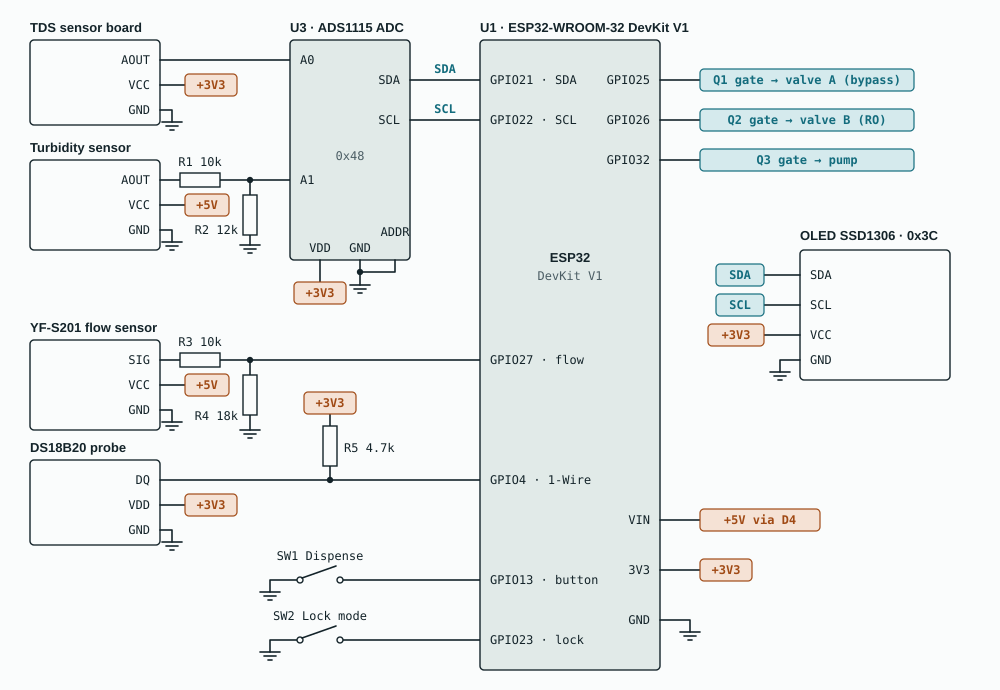

# JalSense

**A smart retrofit for home RO water purifiers: purify only what needs purifying.**

JalSense reads the incoming water and runs the purifier's reverse-osmosis (RO) membrane only when the water actually needs it. When it does, the salty reject water goes to a reuse tank instead of the drain. It fits the purifier a family already owns.

UN Sustainable Development Goal 6, Clean Water and Sanitation. Selected for the prototype round of an SDG hackathon (October 2026, about 150 teams).


## The problem

- RO filtration sends **50–80% of its feed water** down the drain as reject. For every litre drunk, one to four litres are thrown away. [1]
- An expert committee told India's National Green Tribunal that **below 500 mg/L TDS, RO is not useful**: it strips important minerals and wastes water. [2] The NGT's order to restrict RO was later stayed by the Supreme Court [3], so homes still have no practical fix.
- Bengaluru needed about **2,600 million litres a day** in the 2024 crisis and was about **500 million litres short**; around 60% of residents relied on tanker water. [4]

Households can't tell when their water actually needs RO, so they run it on every litre.

## How JalSense decides

> If the incoming water is under 300 ppm TDS and clear, skip the RO membrane. Otherwise run RO and send the reject to a reuse tank. Any sensor fault, or lock mode, forces RO.

| If the sensors read… | JalSense does this |
|---|---|
| TDS below 300 ppm and clarity at least 85% of clear water | **Bypass**: UF + UV only, RO skipped |
| TDS at or above 300 ppm, or cloudy water | **RO**, reject to the reuse tank |
| TDS probe reads under 20 ppm (dry or unplugged), or turbidity signal under 0.3 V | **RO** (fail-safe) |
| Lock switch on, for arsenic or fluoride areas | **RO**, always |

UV/UF disinfection stays on in both paths; only the RO membrane is skipped. The fault checks run before the water-quality checks, so a broken sensor can never cause a bypass.


## Hardware

| Block | Parts |
|---|---|
| Controller | ESP32 DevKit V1 (ESP32-WROOM-32) |
| Sensing | Analog TDS sensor and turbidity sensor read by an **ADS1115 16-bit ADC**; DS18B20 temperature probe for TDS compensation; YF-S201 flow sensor |
| Switching | Two 12 V normally-closed solenoid valves and a 12 V pump, each driven by an IRLZ44N logic-level MOSFET with a flyback diode |
| Interface | 0.96" SSD1306 OLED, Dispense button, lock-mode switch, phone dashboard over the ESP32's own Wi-Fi |
| Power | 12 V 2 A adapter, LM2596 buck to 5 V, ESP32 regulator for 3.3 V |

Parts cost about **₹3,800** for the retrofit kit (≈ ₹4,800 for the full bench demo rig). Full parts list, wiring table and pre-power checklist: [`hardware/`](hardware/README.md).

**Why an external ADC?** The ESP32's built-in ADC is inaccurate below about 150 mV. Water at 50 ppm reads about 0.12 V and a dry probe reads near 0 V, so the built-in ADC could not tell them apart, which would break the fail-safe. [6]



The power and driver sheets are in [`hardware/`](hardware/README.md).

## Firmware

[`firmware/JalSense/JalSense.ino`](firmware/JalSense/JalSense.ino), Arduino framework for ESP32.

- Reads TDS (temperature-compensated), clarity and temperature every second, with a 15-sample median filter
- Fail-safe decision logic (lock mode and sensor faults first)
- Non-blocking dispense state machine: the valve opens 200 ms before the pump starts and closes 300 ms after it stops; the pump stops on target volume, after 3 s of no flow (dry-run protection) or at a 20 s cap
- Flow metering by interrupt; litres saved (bypass) and reused (RO reject) counted per session
- OLED readout and a phone dashboard served from the ESP32's own Wi-Fi hotspot (no internet needed)
- Calibration over the serial monitor, stored in flash

Compiles without sketch warnings on ESP32 Arduino core **2.0.9** and **3.3.12**.

**Build:** Arduino IDE 2 → Boards Manager: *esp32 by Espressif Systems* → Library Manager: *OneWire*, *DallasTemperature*, *Adafruit SSD1306* (with Adafruit GFX and BusIO), *Adafruit ADS1X15* → board *ESP32 Dev Module* → upload.

**Phone dashboard:** join Wi-Fi `JalSense-Demo` (password `jalsense123`), turn off mobile data, open `http://192.168.4.1`.

| Serial command (115200 baud, Newline) | Does |
|---|---|
| `p180` | calibrate TDS against a TDS pen reading of 180 ppm |
| `c` | clear-water calibration for the turbidity sensor |
| `r`, then `l960` | flow calibration: reset pulses, dispense into a jug, enter mL collected |
| `s` | print current readings and the decision |
| `x` | reset calibration to defaults |

Step-by-step: [`docs/calibration.md`](docs/calibration.md).

## Repository layout

```
JalSense/
├── firmware/JalSense/JalSense.ino   ESP32 firmware
├── hardware/
│   ├── README.md                    parts list, wiring table, pre-power checklist
│   ├── bom.csv                      parts list as a spreadsheet
│   └── schematic-*.svg              power, controller and driver sheets
└── docs/
    ├── flowchart.svg, demo-rig.svg
    ├── calibration.md
    ├── design-notes.md              why each part of the circuit is there
    ├── faq.md                       questions about safety, cost and feasibility
    ├── demo-script.md               the live demo, act by act
    └── troubleshooting.md
```

## Status

- [x] Concept, research and pitch (round one)
- [x] Circuit design, wiring table and parts list
- [x] Firmware written and compiling for ESP32
- [ ] Bench prototype, calibration and reliability testing
- [ ] Round-two prototype demo, 24 October 2026

The firmware has not yet run on real hardware. This section will be updated with photos and measured results after the build.

## Real and simulated in the demo rig

The sensing, decision, valve switching, pump control, flow metering, fail-safes and dashboards are real. The RO membrane and the UF/UV stages are represented by labelled jars, and the reject volume on the RO path is calculated at 75% of that path's flow, inside the 50–80% range RO units waste. In a home, mains or tank pressure replaces the pump and the two outlets feed the purifier's own stages.

## Limits

- TDS does not detect microbes, so UV/UF disinfection always stays on.
- TDS does not detect arsenic, fluoride or nitrate; homes in affected areas use lock mode, set from a lab test or the district groundwater report.
- The low-cost turbidity sensor detects visibly cloudy water but cannot resolve 1 NTU; a product version would use a nephelometric sensor.
- Household savings figures are estimates (10 L/day purified at a 75% reject rate) until a pilot measures them.

## Team

Built by Team JalSense for an SDG hackathon. Maintained by [Miheer Nikam](https://github.com/nmiheer715-hue), Electrical and Electronics Engineering, BMS College of Engineering, Bengaluru.

## Sources

1. [Deccan Herald: RO filters waste 50–80% of feed water](https://www.deccanherald.com/opinion/regulatory-vacuum-unregulated-splurge-2144644)
2. [The Tribune: NGT order on RO below 500 mg/L TDS](https://www.tribuneindia.com/news/archive/nation/ngt-ban-ros-where-dissolved-solids-in-water-below-500-mg-l-779571)
3. [Verdictum: Supreme Court stays the NGT order](https://www.verdictum.in/top-stories/sc-stays-order-of-ngt-directing-cpcb-to-ban-water-purifiers-with-tds-below-500-mgl-1357253)
4. [Business Today: Bengaluru water shortfall, March 2024](https://www.businesstoday.in/india/story/bengaluru-facing-shortage-of-500-million-litres-water-shortage-per-day-says-karnataka-cm-421978-2024-03-19)
5. [DFRobot SEN0244 analog TDS sensor](https://wiki.dfrobot.com/sen0244/)
6. [Espressif ESP-IDF: ESP32 ADC](https://docs.espressif.com/projects/esp-idf/en/v4.4.8/esp32/api-reference/peripherals/adc.html)
7. Bureau of Indian Standards, IS 10500:2012 Drinking Water Specification

## License

[MIT](LICENSE)
