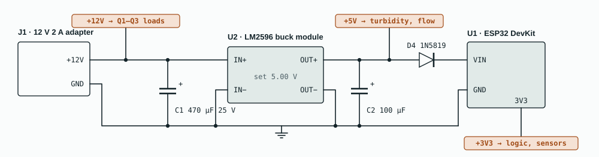
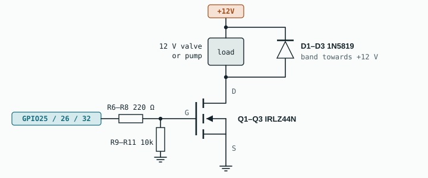

# Hardware

Three schematic sheets, the parts list, the wiring table and the checks to run before first power-on. Wires that end in a coloured tag connect by name to every other tag with the same name, like a KiCad net label. Copper tags are power rails; teal tags are signals.

## Schematic

**Sheet 1, power.** The valves and pump run straight from 12 V. The LM2596 makes 5 V. D4 lets USB and the 12 V adapter both be connected without the two 5 V sources pushing current into each other. The ESP32's own regulator makes 3.3 V. All grounds are common.

**Sheet 2, controller and sensors.** The dividers keep every input inside safe limits: turbidity tops out at 4.5 × 12/22 = 2.45 V, and 5 V flow pulses arrive as 5 × 18/28 = 3.2 V. The ADS1115 shares the I2C bus with the OLED. The buttons use the ESP32's internal pull-ups.

**Sheet 3, one driver channel, built three times.** The 10 kΩ pull-down holds each MOSFET off while the ESP32 boots. The diode catches the voltage spike when a coil switches off. On the pump channel only, C3 (100 nF ceramic) sits across the pump terminals.

| Channel | ESP32 pin | Gate resistor | Pull-down | Load |
|---|---|---|---|---|
| Q1 | GPIO25 | R6 220 Ω | R9 10 kΩ | Valve A, bypass path |
| Q2 | GPIO26 | R7 220 Ω | R10 10 kΩ | Valve B, RO path |
| Q3 | GPIO32 | R8 220 Ω | R11 10 kΩ | Pump, with C3 100 nF across it |

## Parts list

Prices are estimates for Bengaluru retail in October 2026. Also available as [`bom.csv`](bom.csv).

| Part | Qty | Specification | ≈ ₹ |
|---|---:|---|---:|
| ESP32 DevKit V1 | 1 | ESP32-WROOM-32, 30-pin | 450 |
| ADS1115 ADC module | 1 | 16-bit, 4-channel, I2C | 300 |
| TDS sensor kit | 1 | analog board + probe, 3.3–5.5 V, 0–1000 ppm | 400 |
| Turbidity sensor module | 1 | analog output 0–4.5 V, 5 V supply | 400 |
| DS18B20 waterproof probe | 1 | stainless tip, 1 m cable | 150 |
| Flow sensor YF-S201 | 1 | 1/2-inch Hall-effect, needs about 1 L/min (YF-S401 for lower flow) | 250 |
| OLED display | 1 | 0.96-inch SSD1306, I2C | 220 |
| 12 V solenoid valve, normally closed | 2 | direct-acting, 0 MPa minimum pressure | 750 |
| IRLZ44N MOSFET | 4 | logic-level, TO-220 (3 + 1 spare); not IRFZ44N | 200 |
| 1N5819 Schottky diode | 4 | D1–D3 flyback, D4 supply | 20 |
| Resistors | 11 | 220 Ω ×3, 10 kΩ ×5, 12 kΩ, 18 kΩ, 4.7 kΩ | 30 |
| Capacitors | 3 | 470 µF 25 V, 100 µF 16 V, 100 nF ceramic | 25 |
| LM2596 buck module | 1 | adjustable | 100 |
| 12 V 2 A adapter + DC jack | 1 | 5.5 × 2.1 mm barrel | 250 |
| Push button + toggle switch | 2 | momentary; SPDT | 30 |
| 12 V mini diaphragm pump *(demo rig)* | 1 | R385 type, self-priming | 300 |
| Breadboard, jumpers, perfboard, terminals *(demo rig)* | — | | 250 |
| TDS pen meter *(demo rig)* | 1 | calibration reference | 250 |
| Tubing kit *(demo rig)* | — | 8 mm silicone tube, T-joint, clamps, barbs | 300 |
| Clear containers *(demo rig)* | 3 | inlet tank and two output jars | 150 |
| **Total, full demo rig** | | retrofit kit alone ≈ ₹3,520 + ₹300 custom PCB | **4,825** |

## Wiring table

| From | To | Net / note |
|---|---|---|
| Adapter + | LM2596 IN+, valve A +, valve B +, pump +, D1–D3 bands | +12V |
| Adapter − | LM2596 IN− and OUT−, ESP32 GND, every sensor GND, Q1–Q3 sources | GND (common) |
| LM2596 OUT+ | D4 anode, turbidity VCC, flow sensor red | +5V |
| D4 cathode (band) | ESP32 VIN | about 4.7 V |
| ESP32 3V3 | ADS1115 VDD, TDS board VCC, OLED VCC, DS18B20 red, R5 | +3V3 |
| C1 470 µF | +12V to GND, near the valves | stripe to GND |
| C2 100 µF | +5V to GND | stripe to GND |
| TDS board AOUT | ADS1115 A0 | 0–2.3 V |
| Turbidity AOUT | R1 10 kΩ → ADS1115 A1; R2 12 kΩ from A1 to GND | at most 2.45 V |
| ADS1115 ADDR | GND | address 0x48 |
| ADS1115 SDA, OLED SDA | ESP32 GPIO21 | SDA |
| ADS1115 SCL, OLED SCL | ESP32 GPIO22 | SCL |
| Flow sensor yellow | R3 10 kΩ → GPIO27; R4 18 kΩ from GPIO27 to GND | 5 V pulses → 3.2 V |
| DS18B20 data | GPIO4; R5 4.7 kΩ to +3V3 | 1-Wire pull-up |
| SW1 push button | GPIO13 and GND | Dispense |
| SW2 toggle | GPIO23 and GND | closed = lock mode |
| GPIO25 / 26 / 32 | R6 / R7 / R8 (220 Ω) → gate of Q1 / Q2 / Q3 | valve A / valve B / pump |
| Each gate | R9 / R10 / R11 (10 kΩ) to GND | off at boot |
| Q1–Q3 drain | load − terminal; source to GND | |
| D1–D3 | across each load, band to +12 V | flyback |
| C3 100 nF | across the pump terminals | pump only |

## Before first power-on

- Set the LM2596 to 5.00 V with a multimeter while nothing is connected to its output.
- Check the MOSFET marking says **IRLZ44N**. The IRFZ44N looks identical but needs 10 V on the gate.
- Diode bands: D1–D3 towards +12 V; D4 towards ESP32 VIN.
- Spin the flow sensor's wheel and measure GPIO27: it should swing between about 0 V and 3.2 V. If the high level is below 2.6 V, change R3 to 4.7 kΩ.
- Run the 12 V and load ground wires straight back to the adapter, not through a breadboard's thin rails.
- Mount the electronics above the water line, with a drip tray under the plumbing.

## If the valves won't open

Many 1/2-inch plastic valves are pilot-operated and need about 0.02 MPa (0.2 bar) to open, which a small pump may not supply. Use direct-acting valves. If a valve still won't open at pump pressure, replace the single pump and two valves with two R385 pumps, one per path, fed from one T after the flow sensor. Wire them to the Q1 and Q2 channels and leave Q3 empty; the firmware works unchanged.
