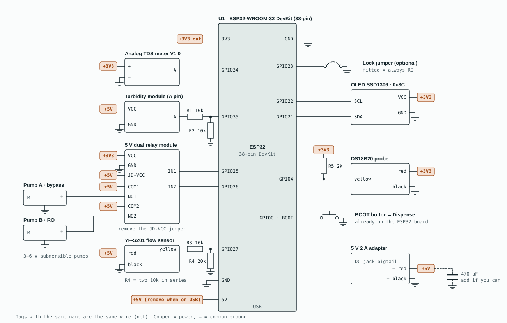

# Hardware

The JalSense prototype is built on a breadboard from off-the-shelf modules. No custom PCB.

## Wiring diagram

Wires that end in a coloured tag connect by name to every other tag with the same name: all **+5V** tags are the breadboard rail fed by the adapter, all **+3V3** tags are a rail fed from the ESP32's 3V3 pin, and every ground symbol goes to the shared GND rail. A 2600 × 1660 PNG for slides: [`jalsense-wiring.png`](jalsense-wiring.png).

Dividers keep every input inside the ESP32's limits: turbidity 4.5 V × 10/20 = 2.25 V at GPIO35; flow pulses 5 V × 20/30 = 3.3 V at GPIO27.

## Parts list

Also available as [`bom.csv`](bom.csv). Prices marked ≈ are estimates.

| Part | Qty | Job | ₹ |
|---|---:|---|---:|
| ESP32-WROOM-32 DevKit, 38-pin | 1 | controller, Wi-Fi dashboard | ≈ 400 |
| Analog TDS meter V1.0 | 1 | dissolved salts in the inlet water | 350 |
| Turbidity sensor with module | 1 | detects cloudy water | ≈ 450 |
| DS18B20 waterproof probe, 1 m | 1 | temperature compensation for TDS | ≈ 120 |
| YF-S201 water flow sensor | 1 | litres on the bypass path | — |
| 5 V dual relay module with optocoupler | 1 | switches pump A and pump B | ≈ 90 |
| DC 3–6 V mini submersible pump | 2 | pump A = bypass, pump B = RO | ≈ 140 |
| 0.96" OLED, SSD1306, I2C | 1 | live readings and decision | ≈ 220 |
| 5 V 2 A adapter | 1 | powers everything | ≈ 150 |
| DC jack female pigtail, 2.1 × 5.5 mm | 1 | adapter to breadboard rails | ≈ 25 |
| MB102 830-point breadboard | 1 | holds the circuit | ≈ 120 |
| Resistor packs: 1 kΩ, 2 kΩ, 10 kΩ | 3 | dividers and DS18B20 pull-up | 30 |
| 6 mm silicone tube | 1 m | pump outlets to the jars | 15 |
| **Total** | | | **≈ 2,100** |

Worth adding (about ₹100): another metre of 6 mm tube, two 1/2-inch to 6 mm hose-barb reducers for the YF-S201, a 470 µF 16 V capacitor across 5V and GND, and jumper wires.

## Wiring table

| From | To | Net / note |
|---|---|---|
| DC jack red (+) | breadboard red rail | +5V |
| DC jack black (−) | breadboard blue rail | GND |
| +5V rail | ESP32 5V pin (unplug when on USB), turbidity VCC, flow sensor red, relay JD-VCC, relay COM1 and COM2 | +5V |
| ESP32 3V3 pin | TDS +, OLED VCC, DS18B20 red, relay VCC, R5 | +3V3 |
| ESP32 GND | GND rail; every module's GND / black / − | GND |
| TDS board A | GPIO34 | 0–2.3 V |
| Turbidity A | R1 10 kΩ → GPIO35; R2 10 kΩ from GPIO35 to GND | at most 2.25 V |
| Flow sensor yellow | R3 10 kΩ → GPIO27; R4 (two 10 kΩ in series) from GPIO27 to GND | 5 V pulses → 3.3 V |
| DS18B20 yellow | GPIO4; R5 2 kΩ from GPIO4 to +3V3 | 1-Wire pull-up |
| OLED SDA / SCL | GPIO21 / GPIO22 | I2C, address 0x3C |
| Relay IN1 / IN2 | GPIO25 / GPIO26 | LOW = relay on |
| Relay NO1 | pump A red; pump A black to GND | bypass path |
| Relay NO2 | pump B red; pump B black to GND | RO path |
| BOOT button (on the board) | GPIO0 | Dispense |
| Jumper wire (optional) | GPIO23 to GND | fitted = lock mode |

## Before first power-on

- **Relay module:** remove the jumper between JD-VCC and VCC. Feed VCC from 3V3 and JD-VCC from 5V. With 3.3 V on VCC, the ESP32's HIGH switches the relay fully off.
- **USB rule:** when the laptop's USB cable is plugged in, unplug the wire from the 5V rail to the ESP32's 5V pin (keep GND connected).
- **Flow signal:** spin the flow sensor's wheel and measure GPIO27: it should swing between about 0 V and 3.3 V. If the high level is below 2.6 V, change R3 to 1 kΩ.
- **Turbidity module:** use its A (analog) pin, not D.
- Keep the breadboard above the water line, with a tray under the plumbing.

## Notes

- The **LM2596** step-down module isn't used: it can't make 5 V from a 5 V adapter. Keep it as a spare.
- The **YF-S201** counts reliably from about 1 L/min. If a mini pump through 6 mm tube barely registers, set `USE_FLOW_SENSOR` to `false` in the firmware and both paths are metered by calibrated pump run time.
- In a **product**, the two pumps become two 24 V solenoid valves on the purifier's own water pressure, switched by MOSFETs rather than relays.
